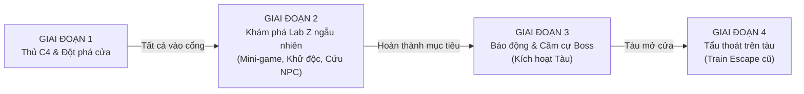
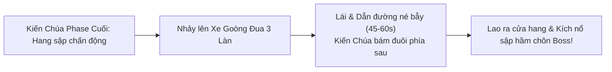

# TÀI LIỆU THIẾT KẾ & ĐẶC TẢ KỸ THUẬT: LAB Z & XE GOÒNG HẦM MỎ

**Cập nhật:** 29/10/2026  
**Mục đích tài liệu:** Bản đặc tả Game Design & Technical Spec hoàn chỉnh dành cho Agent lập trình tiếp theo triển khai vào mã nguồn game (`js/13-labz.js`, `js/09-cave.js` và các module liên quan).  
**Phạm vi:** 
1. **Phần A**: Rework toàn diện **Phòng Thí Nghiệm Z & Nhà Ga X (Map 15)**.
2. **Phần B**: Rework cơ chế tẩu thoát Boss **Xe Goòng Hầm Mỏ (Map 14)**.

---

# PHẦN A: PHÒNG THÍ NGHIỆM Z & NHÀ GA X (MAP 15)

## 1. Giai Đoạn 1: Thủ C4 (Breach Phase)
- **Nhiệm vụ**: Bảo vệ Binh sĩ / Khối nổ C4 phá cánh cửa hợp kim lớn dẫn vào khu nghiên cứu ngầm (20–30 giây).
- **Chuyển map**: Khi C4 nổ tung, yêu cầu **tất cả người chơi còn sống** bước vào vùng cửa vỡ để kích hoạt hiệu ứng chuyển cảnh tải sang map ngầm Lab Z.

## 2. Giai Đoạn 2: Khám Phá Lab Z Ngẫu Nhiên (Procedural Lab)
Bản đồ sinh ngẫu nhiên theo thuật toán (Procedural Dungeon Generation) gồm mạng lưới các phòng tối kết nối qua hành lang hẹp.

### A. Rò Rỉ Khí Độc (Sau 3 phút)
- **0 – 180s**: Không khí bình thường.
- **Sau 180s**: Báo động rò rỉ khí độc cấp cao.
- **Debuff toàn map**: Đốt máu theo % mỗi giây (DoT) + Suy yếu (giảm 15% tốc chạy & giảm sát thương).
- **Hóa giải**: Khởi động đủ **3 Máy Khử Độc** ở 3 phòng nghiên cứu tại 3 hướng (Đông, Tây, Bắc/Nam).

### B. Hệ Thống 3 Loại Cửa & Hack Co-op
1. **Cửa hỏng**: Đi qua tự do.
2. **Cửa đóng thường**: Tương tác mở/bẻ khóa (1.5 – 2.5s).
3. **Cửa bảo mật cao**: Mở bằng **Thẻ Từ (Keycard)** hoặc **Mini-game Hack**:
   - **Người hack bất động**: Không thể bắn súng hay di chuyển; đồng đội phải bọc lót bảo vệ.
   - **Cơ chế Thất Bại (Fail)**: Bị quái đánh trúng hoặc giải sai sẽ kích hoạt còi báo động gọi **Đợt Phục Kích (Ambush)**. Dọn sạch quái sẽ được tiếp tục giải từ bước/checkpoint đó (không bị reset về 0).
   - **Random 3 Dạng Mini-game Hack**:
     - *Dạng 1: Nối đường ống / mạch điện (Circuit/Pipe Connect)*.
     - *Dạng 2: Hiệu chuẩn tần số sóng / Căn vạch nhịp (Frequency Calibration)*.
     - *Dạng 3: Quét ma trận mã Hex (Matrix Breach kiểu Cyberpunk)*.

### C. Phân Loại Phòng Chức Năng
- **Sảnh chính**: Điểm bắt đầu, rộng, quái spawn chậm, ít đồ tiếp tế.
- **Phòng trống**: Ít quái, có đạn và băng cứu thương.
- **Phòng phục kích**: Còi hú, cửa sập khi vào; nhiều quái và quái đột biến; rơi loot xịn/thẻ từ.
- **Văn phòng**: Chứa **1–2 Bản Thiết Kế / Tài Liệu Mật** nhiệm vụ.
- **3 Phòng Khử Độc**: Chứa 3 Máy lọc khí khổng lồ.
- **1–2 Phòng Nghỉ Cố Thủ**: Chứa **1–2 Nhà Khoa Học NPC**; cứu xong NPC tự kích hoạt khóa boongke an toàn và thưởng thẻ từ/vật phẩm.

### D. Bộ 3 Zombie Độc Quyền
1. **Scientist**: Cào cận chiến gây độc rút máu theo thời gian.
2. **Acider**: Chết nổ vũng Axit tồn tại 6s, gây sát thương và suy yếu người chơi bước vào.
3. **Chemist**: Quái tầm xa, liên tục phun tia Axit; khi chết phát nổ Axit cực lớn.

## 3. Giai Đoạn 3: Báo Động, Kích Hoạt Tàu & Cầm Cự Boss
- Còi báo động kích hoạt đợt quái tràn ngập vô tận (Endless Horde).
- Kích hoạt bảng điều khiển mở lối ra Nhà Ga X và gọi tàu.
- **Boss The Hucker xuất hiện**: Mục tiêu là **CẦM CỰ / SINH TỒN** (45–60 giây), không bắt buộc phải giết Boss. Hết giờ tàu nổ máy và mở cửa toa để cả đội lên tàu.

## 4. Giai Đoạn 4: Tẩu Thoát Trên Tàu
- Giữ nguyên cơ chế chiến đấu trên nóc tàu của phiên bản trước.

---

# PHẦN B: HẦM MỎ - XE GOÒNG TẨU THOÁT CO-OP (MAP 14)

## 1. Thời Điểm Kích Hoạt
- Thay thế hoàn toàn màn chạy bộ cũ trong hầm `QUEEN_RUN`.
- Khi Boss Kiến Chúa (Ant Queen) còn 20–30% máu, trần hang sụp đổ dữ dội. Cả đội nhảy lên Xe Goòng đặt trên đường ray mỏ để bắt đầu cuộc đua tốc độ cao.

## 2. Cơ Chế Co-op Bất Đối Xứng (Asymmetric Co-op)
Đường ray có **3 làn cố định: Làn Trái - Làn Giữa - Làn Phải**. Tùy số lượng người chơi mà phân chia vai trò:

### A. Chơi Đơn (Solo - 1 Người):
- Màn hình hiển thị cả Radar báo bẫy trước 3s và các phím điều khiển bẻ làn (`A / D` hoặc Mũi tên). Người chơi tự nhìn và tự bẻ lái.

### B. Co-op 2 Người (1 Xe Goòng Đôi):
- **Người Dẫn Đường (Navigator / Spotter)**:
  - *Giao diện*: Sở hữu **Radar địa chất / Đèn pha tầm xa**, thấy trước đường ray và chướng ngại vật phía trước 3–4 giây.
  - *Hạn chế*: Không có quyền bẻ lái.
  - *Nhiệm vụ*: Báo hướng qua Mic (*"Trái gấp!"*, *"Vào giữa!"*) hoặc dùng tính năng **Quick Ping (Phím Q/W/E)** bắn mũi tên sáng chỉ đường lên màn hình của đồng đội. Có thể bắn súng lục tiêu diệt kiến con bu thành xe hoặc bắn thùng TNT ven vách để cản Boss.
- **Người Lái Xe (Driver)**:
  - *Giao diện*: Tầm nhìn xa bị bụi đá và bóng tối che khuất, chỉ thấy làn ngay trước mũi xe.
  - *Quyền hạn*: Cầm cần gạt bẻ ray (`A / D`).
  - *Nhiệm vụ*: Phản xạ theo lệnh của Người Dẫn Đường để chuyển làn an toàn.

### C. Co-op 3 – 4 Người (Hệ Thống 2 Xe Goòng Song Song):
- Phân chia thành **2 Xe Goòng (Xe Alpha & Xe Beta)**:
  - **Phòng 3 người**: Xe 1 (1 Lái + 1 Dẫn đường); Xe 2 (1 người tự lái & tự nhìn).
  - **Phòng 4 người**: Chia làm 2 cặp (Mỗi xe có 1 Lái + 1 Dẫn đường).

## 3. Hệ Thống 3 Loại Hiểm Nguy (Hazards) & Biển Báo
Biển báo xuất hiện trước 2.5 – 3.5 giây trên màn hình của Người Dẫn Đường:

| Loại Hiểm Nguy | Biển Cảnh Báo | Hậu Quả Va Chạm | Cách Xử Lý |
| :--- | :--- | :--- | :--- |
| **Đường Sập (Track Collapse)** | Biển vàng viền đen hình đường ray gãy / Đèn đỏ chớp | Rơi hẫng bánh, mất 30% máu xe, choáng cả xe 1.5s | Chuyển sang 1 trong 2 làn lành lặn |
| **Đường Cụt / Đá Vụn (Dead End / Rubble)** | Biển hình chữ X đỏ / Bức tường đá | Xe đâm sầm dừng khựng 1.5s, Boss áp sát cắn đuôi | Đổi làn từ sớm trước khi hết đường |
| **Đá Lở (Falling Stalactite)** | Biển đá rơi + Bóng tròn phóng to trên mặt đất | Đá dội trúng xe, giảm 50% tốc độ xe trong 2s | Né làn có bóng đá rơi |

## 4. Thanh Cự Ly Boss & Điều Kiện Thắng
- **HUD Thanh Cự Ly**: Hiển thị khoảng cách giữa Xe Goòng và Kiến Chúa đang bò bám đuôi.
  - Lái an toàn: Khoảng cách xa (vạch xanh).
  - Va chạm bẫy: Xe khựng lại -> Khoảng cách thu hẹp (vạch đỏ). Nếu Boss chạm vào xe sẽ cào sát thương cực lớn lên người chơi.
- **Điều kiện Thắng**: Sống sót và duy trì tốc độ qua quãng đường hầm (45–60 giây). Khi tới đích, xe lao vút ra ngoài ánh sáng, đồng thời kích nổ kíp nổ sập hầm chôn vùi Kiến Chúa.

---

# PHẦN C: HƯỚNG DẪN TRIỂN KHAI CHO AGENT LẬP TRÌNH (DEV GUIDELINES)

1. **Mã nguồn liên quan**:
   - `js/13-labz.js`: Thay thế logic gen map tĩnh bằng thuật toán sinh phòng ngẫu nhiên, cài đặt 4 phase, giao diện 3 mini-game hack và 3 loại quái mới (`Scientist`, `Acider`, `Chemist`).
   - `js/09-cave.js`: Thay thế hàm `genQueenTunnel` và logic `QUEEN_RUN` bằng trạng thái đua xe goòng 3 làn, hệ thống phân vai Driver/Navigator và đồng bộ mạng (Host gửi dữ liệu chướng ngại vật cho Client).
2. **Đồng bộ Mạng (Networking / PeerJS)**:
   - Host là bên tính toán các chướng ngại vật xuất hiện trên 3 làn và gửi gói tin tọa độ/hazard cho Client.
   - Khi Người Dẫn Đường ping phím `Q/W/E`, gói tin gửi ngay về máy Người Lái Xe để render hiệu ứng mũi tên.
